> **Status (November 13, 2026).** Automated playthroughs reach the Hall of Fame from a fresh save
> in Kanto, Johto and Hoenn, and in one save that plays all three regions in turn. Post-game runs
> pass in every region. The whole set last passed with no retries on merged master on November 11.
> These runs use a debug team and debug heals. Separate runs with a team caught in each region and
> no debug heals also reached every Hall of Fame. A full playthrough by a person, and Battle Net
> balance, are still unverified. [Playthrough evidence](test/overworld/johto-playthrough/README.md) ·
> [Map audit and open checks](maintenance/final-pass/zone-status.md)

<div align="center">

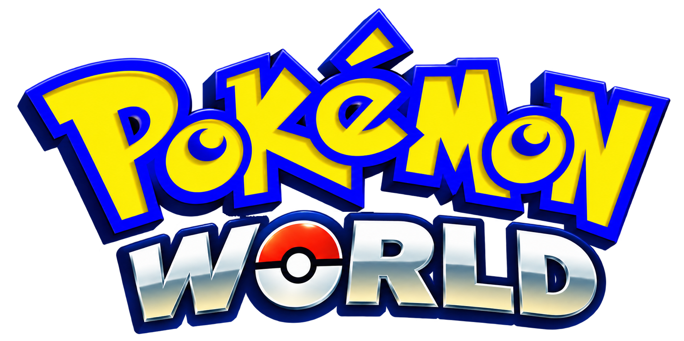

**Three regions. One connected adventure. One cartridge.**

A Game Boy Advance ROM hack built on
[pokeemerald-expansion](https://github.com/rh-hideout/pokeemerald-expansion).

[**Install**](INSTALL.md) · [**Features**](FEATURES.md) · [**Changelog**](CHANGELOG.md) · [**Credits**](CREDITS.md)

</div>

---

## What it is

Pokémon World puts **Kanto**, **Johto** and **Hoenn** on one GBA cartridge. Each region has its
own story, eight gyms, Elite Four and Champion. You choose a region from the central **World
Transit hub**.

- **Shared across regions:** PC boxes, Pokédex, Bag and money. The Pokémon you raise travel with you.
- **Kept per region:** badges, story flags and trainer defeats. Clearing Hoenn does not give you
  Johto's progress or change Johto's difficulty.
- **Story screen:** open **Story** from the Start menu in the hub or any region. It shows each
  region's status, badges, current chapter, next step and where to go.
  [Controls and coverage](docs/story-progress/README.md).
- **Roster:** Generations 1 to 3, with family trees intact. Later evolutions of Gen 1 to 3 lines
  (for example Togekiss, Electivire, Weavile and Sylveon) stay in and can be obtained. All 339
  Gen 4 to 9 families are compiled out. `make validate` fails if a wild table, gift or trainer
  party still references one.

| | |
|---|---|
| Engine | pokeemerald-expansion 1.16.4 dev, untagged upstream master `82598c4d88` (2026-08-23), past the 1.16.3 release (`include/constants/expansion.h`) |
| ROM | `pokemonworld.gba`, title `POKEMON WRLD`, code `BPEE` |

<details>
<summary><b>Region by region</b></summary>

<br>

- **Hoenn.** The native Emerald campaign, plus HARD Elite Four and Champion rematches. The
  Battle Frontier is the shared post-game facility. You reach it from the hub after you clear any
  one region's League.
- **Johto.** 252 ported maps with tilesets, scripts, trainer rosters and wild tables. It has its own
  town map with Fly and heal locations, and HGSS-style portraits for the gym leaders and Elite Four.
  The post-game includes Red at Mt. Silver, the roaming beasts, the Celebi GS Ball chain, the Ruins
  of Alph, the Bug-Catching Contest, Ho-Oh and Lugia.
- **Kanto.** The FireRed campaign with real FRLG trainer parties and League rosters, the Route 23
  badge gate, and rival **GARY**, who is also the Kanto Champion.
- **Across regions.** The World Transit hub, region switching, per-region access points, a
  three-page trainer card (L and R flip between Hoenn, Kanto and Johto badges), and a wardrobe with
  regional outfits.

</details>

## Screenshots

Native 240 × 160 mGBA screenshots, unretouched. Scenes use disposable saves, debug warps and
synthetic teams and items. Menu and battle fixtures use the production renderer.
[Capture methods and hashes](graphics/branding/screenshots/showcase/README.md).

<table>
  <tr>
    <td>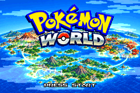</td>
    <td>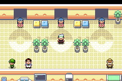</td>
    <td>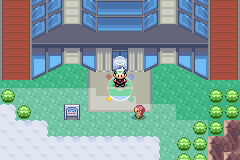</td>
  </tr>
  <tr>
    <td>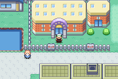</td>
    <td>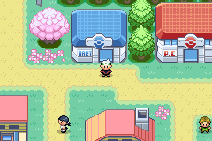</td>
    <td>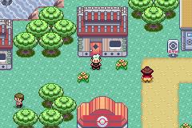</td>
  </tr>
  <tr>
    <td>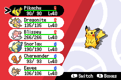</td>
    <td>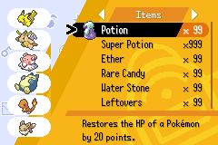</td>
    <td>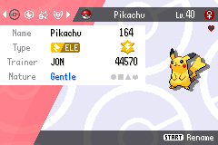</td>
  </tr>
  <tr>
    <td>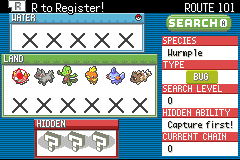</td>
    <td>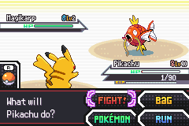</td>
    <td>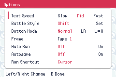</td>
  </tr>
</table>

## Build and test

You need devkitARM. The build uses the modern toolchain only, not agbcc.

```sh
make modern -j8      # produces pokemonworld.gba
```

[INSTALL.md](INSTALL.md) covers setup, toolchain notes and troubleshooting.

| Command | What it does |
|---|---|
| `make modern` | Builds the default ROM. |
| `python3 test/validate-host.py` | Validates host-side content without a game build. |
| `python3 test/verify.py build` | Builds the default ROM in isolation. |
| `python3 test/verify.py smoke` | Builds, then runs the startup, travel and save checks. |
| `python3 test/verify.py full` | Builds, then runs the Lua cases, early regional losses, battle checks, palette check and feature-off builds. |
| `make check TESTS='test name'` | Runs one battle-engine test. |
| `test/overworld/run-all.sh` | Runs the Lua overworld sweep against a ROM you already built. |

Pull requests and `master` pushes run host validation only. Builds and gameplay tests run when you
ask for them, locally or through [Verify on demand](.github/workflows/Verify.yml). Nothing runs on
a schedule, and CI uploads no build output. See the
[native verification guide](test/overworld/mgba/README.md) and the [release gate](RELEASING.md).

## Releases and saves

The last tagged release is **v1.7** (2026-09-30). The [changelog](CHANGELOG.md) lists every change.

The development build uses **save format v12**. It loads v7 to v11 saves and refuses older ones.
Older builds cannot read a v12 save, so keep a backup before you upgrade. Saves from before v11
start with empty travel history, and the new rate options start at 1×.

**Since v1.7 (unreleased):**

- Encounter Rate and Money Loss are options of their own, next to Exp Rate and Catch Rate.
  **Instant** is a new Text Speed.
- Each World Transit gate remembers the team you left the region with, and can return you to the
  last Pokémon Center you entered there.
- The permanent Hard Mode bundle is retired. Champion rematches and battle-facility rules stay.

**v1.7 highlights:**

- A Black/White-style battle interface, with backgrounds that match the place and time of day.
- The **Story** screen in the Start menu.
- Restyled menus, Bag and PC, warm night windows in 49 town maps, redrawn outfit colours, and a
  landscaped Viridian City.
- Friendship, move and partner evolutions also happen at a set level. Eevee evolves by stone only.

<details>
<summary><b>Project layout</b></summary>

<br>

The ROM is built from C source, assembly, JSON data and raw assets, following pokeemerald and
pokeemerald-expansion conventions.

| Path | Contents |
|---|---|
| `src/`, `include/` | Game and engine C source and headers. |
| `include/config/` | Feature-toggle headers. Start here to turn a feature on, off or tune it. |
| `data/` | Event, battle and field scripts; 1,190 registered maps across Hoenn, Kanto and Johto; `layouts/`, `tilesets/`, `text/`. |
| `graphics/`, `sound/` | Image and audio assets, converted at build time. Branding and screenshots are in `graphics/branding/`. |
| `asm/`, `constants/`, `libagbsyscall/` | Hand-written assembly and macros, constant includes, and the GBA BIOS syscall library. |
| `tools/` | Build tools. The Makefile compiles them. |
| `test/` | Battle-engine test suite (`make check`). |
| `test/overworld/` | Project checks: host validators (`Validate*.py`), Lua overworld suites and the campaign playthrough harnesses. |

</details>

## Credits and license

Built on **pokeemerald-expansion** by the RH-Hideout team and its contributors, which is based on
[pokeemerald](https://github.com/pret/pokeemerald) by pret. See [CREDITS.md](CREDITS.md).

_Pokémon World is a free, non-commercial fan project. It is not affiliated with, endorsed by, or sponsored by Nintendo, Game Freak, or The Pokémon Company. No ROMs are distributed. You build the game from source using a legally obtained base ROM. It is not for sale or commercial use._

_All Pokémon names, characters, and related assets are the property of their respective owners. I claim no ownership or credit for any original work this project is based on. This project is provided as-is, with no warranty, and is used at your own risk._
