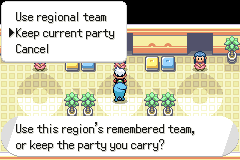
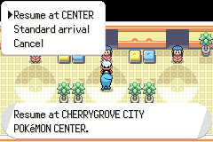
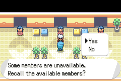

# Regional travel verification

## Provenance

Application and test commit: `e0a9fe871439526a93de3afcfeb54ec7ec81bc6e`.
Base: `35bf05083e22137b08daf26e6d38bd45fb7a99d7` from `origin/master`.
The following documentation commit does not change the tested application or controller scripts.

Configuration is the default development build: `GAME_VERSION=EMERALD`, `ALL_REGIONS=1`, default repository feature switches, no LTO release mode.

- ROM MD5: `30B28AF582B8B400855381A27E3C79FA`.
- ROM SHA-256: `8f1a2d2aff0bd844e75e4a5540a32006bf989997f9ce7fa009dcc3f247bcb4bd`.
- Baseline ROM MD5: `8885ebc29da759d11578660fe8aa3688`.

## Final gates

| Command | Result |
| --- | --- |
| `make modern -j8` | Exit 0, final-build.log. Final default ROM hash matches all final controller runs. |
| Clear `gTestRunnerArgv` with `tools/patchelf/patchelf pokemonworld-test.elf gTestRunnerArgv '\0'`, then `make check -j8` | Exit 0. 5,119 passed, 8 expected failing, 14 known failing, 594 TODO, 5,735 total. |
| `make validate` | Exit 0. Includes all existing validators, the 48-Center inventory, dirty-fixture reproduction, and offline migration checks. |
| `python3 test/overworld/TestRegionalTravelMigration.py` | 5/5 passed, including 433 persisted Pokémon slots and all 24 encrypted substructure orders. |
| `python3 test/overworld/SavePatch.py --probe` | 73/73 target-compiler layout expressions matched. |
| `PW_OUT=/private/tmp/pkmn-377-evidence/final-sweep test/overworld/run-all.sh` | Exit 0. 56/56 expected suites, 1,589 assertions. Every PASS sentinel was fresh and stamped with the final ROM hash. |
| `PW_OUT=/private/tmp/pkmn-377-evidence/travel-runtime-expanded/ test/overworld/mgba-run.sh test/overworld/lua/RegionalTravel.lua` | Exit 0. Expanded suite passed 221/221 against the same unchanged ROM. |
| `gmake modern -j8`, `POKEVIAL_FEATURE=FALSE` | Exit 0. |
| `gmake modern -j8`, `QOL_FIELD_MOVES_ITEM_GATE=FALSE` | Exit 0. |
| `gmake modern -j8`, `PW_GRAPHICAL_START_MENU=FALSE` | Exit 0. |
| `git diff --check` | Passed before each commit. |

The full C suite adds 35 passing tests over the baseline's 5,084 passes. Its inherited expected failures, known failures and TODO counts are unchanged. All three corrupt-record regressions passed, including exact preview/refusal preservation and refusing to reuse an occupied corrupt PC slot.

The complete overworld sweep included RegionalTravel 189/189, RegionalTravelMigration 10/10, and HubPassReCross 71/71. The later 221-assertion standalone adds named save/reload cases and Slateport departures. Only that test script and evidence changed after the full sweep; the application and ROM did not. The optional personal-save suite had no local personal save and was not counted.

The three feature-off builds used an independent copy at `/private/tmp/pkmn-377-flags/`. Each changed one switch to FALSE and restored the prior switch to its original contents before the next build. The source-copy history check used the repository's documented `.histignore` marker. macOS Make 3.81 spent several minutes resolving implicit dependencies on the clean copy, so that attempt was stopped and the installed GNU Make completed all three builds. These are compile checks, not gameplay checks for nondefault configurations.

## Controller coverage and native captures

[Acceptance evidence](acceptance.md) distinguishes controller transitions, production helper tests, and source review. Scenarios include all nine campaign pairs, regional/current teams, resume/standard arrival, partial confirmation, forced whiteout, real save/Continue, maiden SS Aqua and return voyages, neutral Frontier transit, direct Slateport hub entry, and S.S. Tidal boarding to Frontier. The Hoenn League case resumes with a Caterpie that cannot Surf or Fly and escapes through the actual Hub Pass.

The three screenshots below were inspected at native resolution and show the same final ROM used for the tests.

## Evidence location and limits

Full logs and all screenshots remain on this Mac in `/private/tmp/pkmn-377-evidence/`. The committed [result excerpts](results.md) retain the final command summaries. Earlier partial controller runs failed because of test navigation or fixture assumptions and are not counted as passing acceptance.

Baseline build, host validation, HubPassReCross 71/71, and full C checks passed before feature work. Two offline migration negative controls failed as intended when migration or identity-bit clearing was omitted.

These are automated controller tests with seeded prerequisites and C helper tests. They do not establish a fresh-save natural playthrough, physical hardware behavior, 48 physical Center visits, or a dedicated NPC/link trade session. Mail and follower exchange integrity were exercised in C tests, not a dedicated controller exchange. Independent review found one preview mutation defect, which was corrected and regression-tested. The review used the inherited model; it was not a cross-model panel.

## Save compatibility

Format 11 appends 168 bytes to RegionSave. Boxed and party Pokémon remain 80 and 100 bytes. Supported formats 7 through 10 migrate with empty regional history and cleared new identity bits. Older builds refuse format 11. Keep a pre-upgrade save backup for rollback. See [save compatibility](save-compatibility.md).
