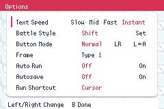
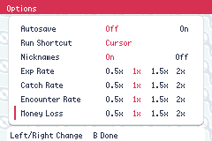

# Family options verification

Issue [#383](https://github.com/evilchinesefood/PKMN-World/issues/383) adds independent Encounter Rate, Money Loss, and Instant text choices and retires the permanent Hard Mode bundle.

## Design and compatibility

| Decision | Reason |
| --- | --- |
| Keep existing subsystem ownership; share rate presentation and one arithmetic helper | Avoid a general settings framework while keeping matching controls consistent |
| Append four bits to the existing option word and migrate to save v12 | Preserve the deprecated Hard Mode bit, adjacent options, and all save-block sizes |
| Preserve EXP and Catch saved encodings | Their displayed order matches, but their stored values differ |
| Opt ordinary land/surf checks into scaling explicitly | The shared encounter helper also serves excluded Rock Smash and facilities |
| Keep Instant asynchronous with per-printer work and frame boundaries | Characters render immediately without consuming waits or multiple prompts in one frame |

The integration owner handled the coupled save, menu, and gameplay changes. Text and acceptance work used disjoint files. Builds were serialized, emulator outputs were isolated, and independent source reviews checked the result. No product decisions remain open.

## Baseline

Baseline commit was `69a7c36e9275f56ad5401ba706e44fd78b9db0b9`. Its modern build, source validators, and existing PromptSafetyEvIv suite passed before edits. The baseline ROM, ELF, symbols, and logs were retained locally.

A controller probe confirmed that leader-simulation forfeits already charged money. With a level-100 party and no badges, the baseline deducted 800 from a 50,000 wallet. This charged path remains charged. Ordinary simulation defeats remain free.

## Final checks

The tested modern ROM has MD5 `7A78B55CBDC4BDA44B44A1D211F88B26`. It was built from the reviewed working tree before commits. Build stamps derived from Git metadata are separate from the gameplay changes.

| Check | Result |
| --- | --- |
| `gmake modern -j8` | Passed, including required Lua symbol generation |
| `gmake validate` | Passed |
| Focused production C tests | 45/45 passed |
| Full production C suite | Passed, exit 0. 5,164 passed, 14 known failures, 594 TODO, and 8 expected failures; no unexpected failures |
| Canonical native Lua sweep | 59/59 suites, 1,782 assertions, exit 0; fresh sentinels bound to the tested ROM |
| Native supported-save matrix | 12/12 cases, 72 assertions, covering v7-v12 with the old Hard Mode bit set and clear |
| Offline migration and layout checks | Passed, including 73 target-compiler layout probes |
| Diff whitespace validation | Passed |

The native suite includes all rate and text selections in both directions, wraparound, staged values, reopen, save/Continue, and travel through Kanto, Johto, and Hoenn. Native captures show readable text-speed labels and aligned rate rows.

The separate battle suite passed 27 assertions. With the old Hard Mode bit set and Instant selected, it opened the trainer-battle Bag, consumed a Potion and healed 20 HP, verified the actual Shift prompt and Set behavior after a knockout, and checked free simulation defeat and unchanged simulation-win money. At 2x Money Loss, the existing 800 forfeit charge became 1,600, and the message displayed that exact deduction.

Production C tests cover new defaults, physical bit masks, dirty-padding migrations, adjacent preferences, v11 travel history, migration idempotence, exact encounter thresholds and RNG state, modifiers and probability caps, ordinary/excluded encounter dispatch, fishing and scripted generation, money rounding and wallet caps, actual battle loss/payout paths, Rare Candy, daycare, battle EXP, and maximum level.

Text tests exercise timed pauses, clear/scroll pages, sound waits, auto-scroll, rapid input, simultaneous printers, callbacks, forced Mid, static UI, and recorded/link playback. Three independent-review findings were fixed and tested:

1. Recorded Instant no longer enters the synchronous printer that consumed waits without frame boundaries.
2. Window transfers are batched per printer per frame. A regression reproduced DMA-queue exhaustion before the fix and verifies actual VRAM for both windows afterward.
3. Callback-controlled suspension takes effect immediately. The Mauville Bard's sung-character timing remains authoritative.

## Interpretation and limits

Two existing RandomUniform checksum assertions exposed a fixture-isolation defect in an earlier full run. The new synchronous fixtures cleared battle flags while retaining a prior battle VBlank callback. Its extra RNG draw produced both observed checksum differences exactly. The fixtures now clear that callback before setup; benchmark expectations and production RNG code are unchanged. The complete rerun passed with exit 0, including both checksum assertions, with no unexpected failures.

The defeat base formula still uses the existing Hoenn badge flags. This change multiplies that result and does not redesign regional badge selection. Champion rematches and facility rules retain their existing paths.

The native tests use disposable saves, debug-created parties, and controlled HP where needed. No natural full-campaign balance run or physical-hardware playthrough is claimed. Saves written as v12 are refused by older builds; no downgrade conversion is provided.

Detailed logs and captures are retained locally for this PR.

## Native menu captures

