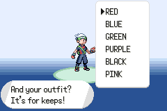
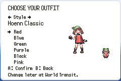
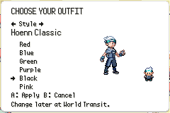
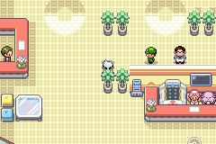
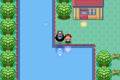

# Wardrobe verification

The shared picker and all six new clothing designs were verified with the
ordinary default game build and a disposable capture fixture. No release tag
or full campaign playthrough was requested.

## Recorded builds

The complete catalog run used source `b3ca233349f85bd9f5b00039f2c282d1c4c87743`.
Its ordinary ROM SHA256 is
`78aebef3cbaa54225b7eefbe953cac0ea860b861237bc1d5b9c6a1e09ea568f9`.
The [full capture manifest](full-capture-manifest.json) binds its fixture and
symbols to that exact ROM.

The branch then rebased onto the independent championship reward fix
`5d50999863484771ec1d6fa00215754d04d939cb`. The wardrobe diff kept stable patch ID
`88a55196ddc721754f6960f0ae6a99571d7012f8`. The rebuilt source is
`d8cfeca02a1d55ea0e993f0096f92c1d806a54a9`. Its ordinary ROM SHA256 is
`f3cd9fc14b3ffcc090b637cd1c11ee6a960ebaf136e27bad82563dc085d9fae1`.
The [rebased capture manifest](rebased-capture-manifest.json) records the fresh
representative checks. Later evidence-only changes do not change game code.

## Results

| Check | Result |
| --- | --- |
| Default game build | Passed before and after rebase |
| Indexed art audit | 6 designs, 36 new combinations, 72 sheets, 558 frames passed |
| All 48 field, reflection, trainer-card, and send-out combinations | 1125 assertions passed |
| New design activity graphics and facing directions | 450 assertions passed |
| Both complete intro catalogs | 157 assertions passed for each protagonist |
| Both physical wardrobe interactions and save/Continue | 42 assertions passed for each protagonist |
| Rebased May intro catalog | 157 assertions passed |
| Rebased Brendan wardrobe interaction | 42 assertions passed |
| Rebased ordinary-ROM PromptSafetyEvIv | 25 assertions passed |
| Rebased host validation | 21 checks passed |

The full pre-rebase capture totals 1973 passing assertions. The rebased native
checks add 224 passing assertions. [Machine-readable results](results.json)
record each run's ROM identity and verdict.

The fixture seeds the party, warps to capture locations, opens the normal card
and battle, and calls the ordinary save routine. Intro and wardrobe selection
use real button input. The hub test interacts with the cabinet before opening
the picker. The pose test deliberately loads production activity graphics,
then checks their live graphics IDs and palettes. It does not prove every
natural gameplay transition, multiplayer path, or complete campaign.

## Legacy graphics regression

Independent review reproduced a saved-template bug in the first implementation.
An ordinary pre-change save in Oldale Town stored rival graphics ID 413, which
means dynamic variable 0. After Continue on the broken wardrobe build, the
saved template spawned graphics 413 instead of the expected rival graphics 105.

The corrected code reserves dynamic IDs 413 through 428 and starts new static
art at 429. The independent reviewer loaded the same save and observed graphics
105 after the same saved-template respawn. The focused wardrobe fixture also
checks both legacy range endpoints through the production resolver, plus the
reserved gap fallback. The original static IDs and outfit values 0 through 5
remain unchanged.

The independent red and green logs remain in the local audit bundle at
`/private/tmp/374-independent/broken-continue/runner.log` and
`/private/tmp/374-independent/pre-fix-continue/runner.log`. The second folder's
name predates the fix and contains the passing fixed-build run.

An older save already inside World Transit retains its saved object list until
a normal map exit and return. The new wardrobe appears after that return. No
progress reset or save migration is needed.

## Native images

The images retain the game's native 240 by 160 resolution.

| Before intro | Shared full-catalog intro |
| --- | --- |
|  |  |

| Physical cabinet | Same picker at the cabinet |
| --- | --- |
|  |  |

| Continue retains Kanto Blue | New underwater garment |
| --- | --- |
|  |  |

The underwater image uses a fixture to display the submerged production sprite
beside the pond. Its dark surrounding silhouette belongs to the submerged pose.
It is not a natural Dive traversal capture.

The [native source catalog](../../../../../graphics/player_outfits/review/catalog.png)
and per-design pose sheets cover all authored frames. The
[decision record](decisions.tsv) records the design choice, concept review,
palette correction, compatibility fix, and rebase verification.
